<!-- ===================== Header ===================== -->
<div align="center">


<a href="https://github.com/ryotaema">
  
</a>

</div>

<!-- ===================== Grass message ===================== -->
<div align="center">
<picture>
  <source media="(prefers-color-scheme: dark)" srcset="./assets/grass-dark.svg" />
  <source media="(prefers-color-scheme: light)" srcset="./assets/grass-light.svg" />
  
</picture>
</div>

<br>

## 🧑‍💻 自己紹介

```python
class Ryotaema:
    affiliation = "千葉工業大学大学院 林原研究室"
    grade       = "M1（2028年卒業見込み）"
    interests   = ["Robotics", "Computer Vision"]
    main_stack  = ["Python", "C++", "YOLO"]
```

<br>

## 🛠️ 技術スタック

<div align="center">

**メイン**<br>

<br>


**言語**<br>


**画像認識・機械学習**<br>

<br>


**ロボット**<br>


**ハードウェア**<br>


**開発環境**<br>


</div>

<br>

## 📌 制作物

<div align="center">
<table>
  <tr>
    <td width="50%" valign="top">
      <h3>🧪 <a href="https://github.com/ryotaema/detection_dev_ui">detection_dev_ui</a></h3>
      CVAT → YOLO → MLflow → FiftyOne を Docker Compose で統合した <b>GUI 完結型の物体検出 MLOps 環境</b>。アノテーションから学習・推論・評価までブラウザだけで完結。
      <br><br>
      <code>YOLO</code> <code>Docker</code> <code>CVAT</code>
    </td>
    <td width="50%" valign="top">
      <h3>📷 <a href="https://github.com/ryotaema/real_syutoku">real_syutoku</a></h3>
      RealSense / Orbbec の <b>深度カメラを機種差なく扱えるデータ収集ツール群</b>。RGB・深度・IR・点群の一括取得、タイムラプス、リアルタイム推論、ICP 点群マージ。
      <br><br>
      <code>RealSense</code> <code>OpenCV</code> <code>OpenVINO</code> <code>Open3D</code>
    </td>
  </tr>
  <tr>
    <td width="50%" valign="top">
      <h3>🏷️ <a href="https://github.com/ryotaema/auto_annotator">auto_annotator</a></h3>
      学習済み YOLO で <b>画像のアノテーションを自動生成</b>。手作業のラベル付けを「下書きの修正」に置き換え、データセット作成を効率化。
      <br><br>
      <code>YOLO</code> <code>Python</code>
    </td>
    <td width="50%" valign="top">
      <h3>🤖 <a href="https://github.com/ryotaema/MCL_for_class">MCL_for_class</a></h3>
      パーティクルフィルタによる <b>2D ロボット自己位置推定 (MCL)</b>。動作・観測モデルを数式から実装し、推定軌跡をアニメーションで可視化。
      <br><br>
      <code>NumPy</code> <code>Matplotlib</code> <code>Probabilistic Robotics</code>
    </td>
  </tr>
</table>
</div>

<br>

## 📊 GitHub の活動

<div align="center">
  
  
  <br>
  
</div>

<br>

## 🌱 コントリビューション

<!-- GitHub Actions で自動生成されます（.github/workflows/snake.yml） -->
<div align="center">
<picture>
  <source media="(prefers-color-scheme: dark)" srcset="https://raw.githubusercontent.com/ryotaema/ryotaema/output/github-snake-dark.svg" />
  <source media="(prefers-color-scheme: light)" srcset="https://raw.githubusercontent.com/ryotaema/ryotaema/output/github-snake.svg" />
  
</picture>
</div>

<br>


